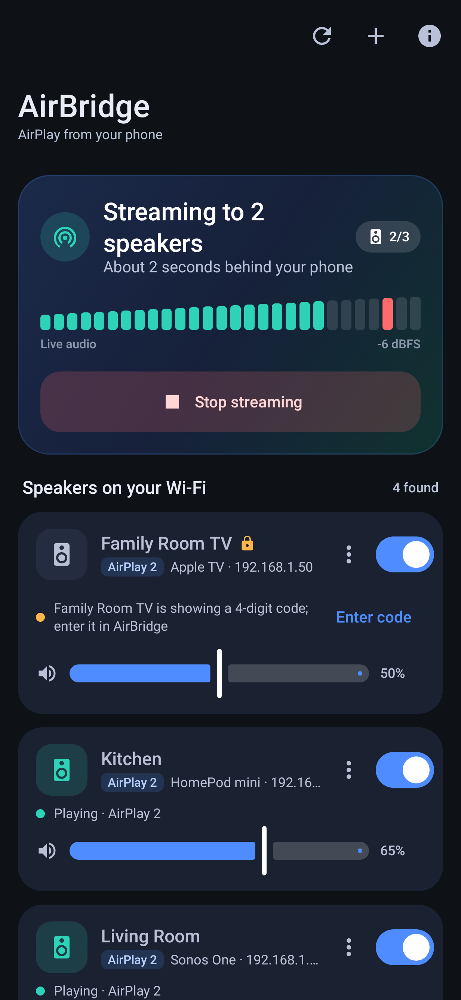
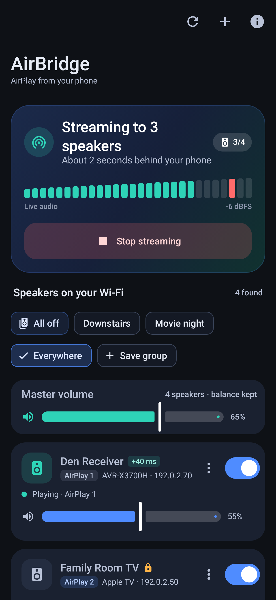
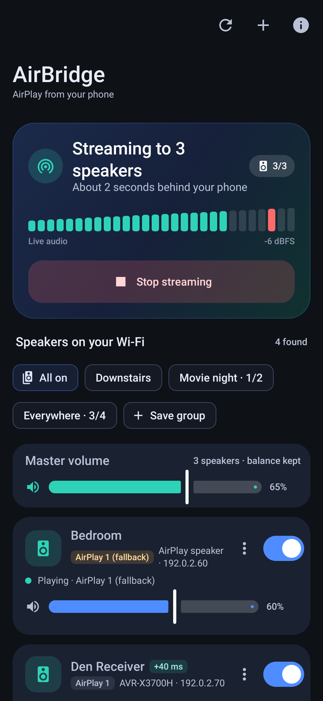

# AirBridge

AirBridge is an Android app that streams the audio playing on your phone to AirPlay speakers over
your local Wi-Fi. It is an AirPlay 1 (RAOP) and AirPlay 2 (HAP pairing) sender for Android 10 and
newer, written in Kotlin with Jetpack Compose.

- **AirPlay 1 and AirPlay 2 in one app:** RAOP for older receivers, and AirPlay 2 with HomeKit
  (HAP) pairing, including the on-screen code of an Apple TV and password-protected speakers.
  Designed for Sonos, HomePod, Apple TV, Denon/Marantz/Yamaha receivers, WiiM, AirPort Express,
  Shairport-Sync and other AirPlay receivers (not yet tested on real hardware; see
  [Status and limitations](#status-and-limitations)). When AirPlay 2 does not connect and the
  speaker also offers AirPlay 1, AirBridge switches to AirPlay 1 and the speaker card shows
  **AirPlay 1 (fallback)** (new in v0.3.0).
- **Multi-speaker:** play to several speakers at once, all on one shared clock. A slow or
  disconnected speaker does not hold up the others.
- **Per-speaker volume and a master volume:** each speaker has its own slider, and the master
  slider moves every speaker that is on while keeping their balance (new in v0.2.0).
- **Per-speaker sync offset (new in v0.2.0):** shift one speaker by up to 250 ms earlier or later,
  in 5 ms steps, to line it up with the others. The change applies while the music plays, without
  reconnecting. Since v0.3.0 the AirPlay 2 stream setup declares a latency window that covers the
  whole -250 to +250 ms range.
- **Saved speaker groups and All on / All off (new in v0.2.0):** save the speakers that are on as
  a group such as "Downstairs", then tap the group to play exactly those speakers. One tap turns
  every speaker on or off, also while streaming.
- **Speakers that change address keep their settings (new in v0.3.0):** when a speaker comes back
  with a new IP address, AirBridge updates its existing card instead of adding a second one, and
  keeps its volume, sync offset, groups and pairing. AirBridge looks for speakers only while it is
  open on screen, so that is when it sees a new address. A speaker that moves while AirBridge is in
  the background or the screen is off reconnects after you open AirBridge again.
- **100% local Wi-Fi:** the only network traffic is mDNS discovery and AirPlay to the speakers on
  your network. No account, cloud service, analytics or ads.

> [!NOTE]
> **Which apps can be streamed.** AirBridge uses Android's standard `AudioPlaybackCapture` API
> (Android 10 and newer): no root and no workarounds. Playback capture works with Spotify and most
> other media apps whenever the app and the phone allow Android playback capture. Capture returns
> silence only when a particular app, or a particular version of it, opts out of capture (for
> example with `android:allowAudioPlaybackCapture="false"` in its manifest). If music is playing
> but AirBridge receives only silence for about 3 seconds, it shows a banner: check that app's
> settings, try another player, or use Spotify Connect or Cast where your speaker supports it.
> AirBridge never requests audio focus, so the app that is playing keeps playing when streaming
> starts.

## Screenshots

| Ready | Streaming a saved group | Every speaker on |
|:---:|:---:|:---:|
|  |  |  |

| Sync offset | Silent-capture warning | AirPlay 1 fallback |
|:---:|:---:|:---:|
|  |  |  |

The screenshots are rendered from the real Compose UI with sample speakers and addresses from the
192.0.2.0/24 documentation range (see [docs/BUILD-TEST-REPORT.md](docs/BUILD-TEST-REPORT.md)).
The silent-capture warning shows what AirBridge displays when the playing app opts out of capture;
the AirPlay 1 fallback screenshot shows a speaker that refused AirPlay 2.

## Quick install (Android phone)

1. On your Android phone, open the
   [v0.3.0-debug release](https://github.com/edge-sentinel-crypto/airbridge-android/releases/tag/v0.3.0-debug)
   and download **`AirBridge-debug.apk`** (about 29 MB). Direct link:
   <https://github.com/edge-sentinel-crypto/airbridge-android/releases/download/v0.3.0-debug/AirBridge-debug.apk>
2. Open the downloaded file. When Android asks, allow installs from that source.
3. Tap **Install** (or **Update**), then **Open**. Play Protect may warn about an unknown developer,
   because this build is signed with the standard Android debug key, not a Play Store key; tap
   **More details > Install anyway**.
4. Turn on the speakers you want, start music in another app, and tap **Start streaming**.

Already have v0.1.0-debug or v0.2.0-debug? Install v0.3.0-debug over it; do not uninstall first. It
has the same package name (`com.airbridge.airplay`) and the same signing key, and a higher version
code (3), so Android updates the app in place and keeps your speakers, volumes, sync offsets,
groups and pairings.

SHA-256 of `AirBridge-debug.apk` (v0.3.0-debug, 29,333,668 bytes):

```
6c10a385e5f222e86f4b5ed410b68d0837f013a45b7182422a9561ba6d3d5dc5
```

Full instructions (checking the hash, copying from a computer, ADB, first-run permissions,
troubleshooting): [docs/INSTALL.md](docs/INSTALL.md).

## Build from source

Requirements: JDK 17 and the Android SDK with Platform 35 (`platforms;android-35`) and Build-Tools
35.0.0. Set `JAVA_HOME`, and set `ANDROID_HOME` (or put `sdk.dir=<path to the SDK>` in
`local.properties`).

```bash
git clone https://github.com/edge-sentinel-crypto/airbridge-android.git
cd airbridge-android
./gradlew testDebugUnitTest assembleDebug lintDebug
```

- `testDebugUnitTest` runs 155 unit and loopback integration tests, including complete AirPlay 1 and
  AirPlay 2 sessions against mock receivers over real sockets on 127.0.0.1, the multi-room features
  (master volume, sync offset, groups, All on / All off) driving live mock speakers, and the v0.3.0
  checks: a strict mock AirPlay 2 receiver that rejects any sync packet outside the latency window
  of the stream setup, the 48 kHz to 44.1 kHz converter, the capture-rate fallback, lock handling,
  speakers that change address, and the AirPlay 1 fallback label. Two interop tests use FFmpeg and
  Python when they are installed and are skipped otherwise.
- `assembleDebug` writes `app/build/outputs/apk/debug/app-debug.apk`. It is signed with your own
  debug key, so its SHA-256 differs from the release APK.
- `lintDebug` runs Android lint with `abortOnError = true`.

The same sources are also published, file for file, in the `airbridge-android/` folder of
[edge-sentinel-crypto/edge-sentinel](https://github.com/edge-sentinel-crypto/edge-sentinel). That
folder is a standalone project: it shares no code with Edge Sentinel and has its own Gradle build,
so run the Gradle commands from inside it.

The build is tested on Linux (Ubuntu 24.04 under WSL2). Step-by-step toolchain setup on Linux or
WSL, without sudo: [docs/INSTALL.md, section 7](docs/INSTALL.md#7-building-the-apk-from-source).
On Windows, `gradlew.bat` replaces `./gradlew` (not tested).

## How it works

1. Android's AudioPlaybackCapture API gives AirBridge the audio other apps play, as 16-bit stereo.
   AirBridge asks for 44.1 kHz, the AirPlay rate. If the phone cannot capture at 44.1 kHz, AirBridge
   captures at 48 kHz and converts the audio to 44.1 kHz itself (new in v0.3.0). Android asks for
   your consent each time you start streaming. AirBridge never uses the microphone, although Android
   requires the `RECORD_AUDIO` permission for capture, and it never requests audio focus.
2. A foreground service with a notification and a Stop button keeps streaming with the screen off.
   (Some Android versions end capture when the phone locks; AirBridge then stops, releases the
   capture and its wake and Wi-Fi locks, and says so.)
3. Speakers are found with mDNS (`_raop._tcp` and `_airplay._tcp`) while AirBridge is open on
   screen, or added by IP address.
4. The audio is encoded once as ALAC (plain PCM for receivers that accept only PCM) and sent to
   every selected speaker, each with its own connection and thread, on one shared timeline.
5. Speakers play about 2 seconds behind the phone (the AirPlay network buffer), so AirBridge suits
   music, not lip-sync with video.
6. A speaker's sync offset changes only the delay AirBridge announces to that speaker in its RTP
   sync packets: -250 ms plays it earlier, +250 ms later (1.75 to 2.25 s in total). For AirPlay 2
   speakers the stream setup declares `latencyMin` 11,025 and `latencyMax` 99,225 frames
   (0.25 to 2.25 s), so every offset in that range stays inside the declared window.

Details: [docs/PLAN.md](docs/PLAN.md).

## Status and limitations

- **Not yet tested on real hardware.** The protocol engine is covered by the automated tests above,
  but no real phone or speaker was used in this build. Whether each speaker model accepts the
  AirPlay 2 session, and how each phone handles playback capture (including the 48 kHz fallback),
  still needs checking on real devices.
- **AirPlay 2 timing uses NTP, not PTP.** PTP needs UDP ports 319/320, which Android apps cannot
  open without root. Receivers that reject NTP fall back to AirPlay 1 automatically when they offer
  it; the speaker card then shows **AirPlay 1 (fallback)**, and each speaker's menu can force
  AirPlay 1 or AirPlay 2.
- **Sync offset and AirPlay 2.** v0.2.0 announced `latencyMax` 88,200 frames (2.0 s) at stream
  setup while a positive offset asked for up to 2.25 s. v0.3.0 declares 11,025 to 99,225 frames,
  which contains every latency the sync packets can carry for -250 to +250 ms, whether a receiver
  checks the announced latency or the total including the 0.25 s it adds itself. Changing an
  offset mid-stream sends a new sync packet at once; whether every receiver model re-aligns
  smoothly (or skips briefly) still needs checking on real hardware.
- **Debug build.** The APK reports versionName 0.3.0 (versionCode 3) and is published as release
  `v0.3.0-debug`. (Earlier releases: `v0.2.0-debug` reported versionName 0.2.0 and versionCode 2;
  `v0.1.0-debug` reported versionName 1.0.0 and versionCode 1.)
- More in [docs/PLAN.md, section 12](docs/PLAN.md#12-limitations-and-risks).

## Documentation

- [docs/PLAN.md](docs/PLAN.md): plan and architecture (capture, discovery, AirPlay 1 and 2 engines,
  multi-speaker timing, master volume, sync offset, groups, privacy).
- [docs/INSTALL.md](docs/INSTALL.md): installing, first run, everyday use, troubleshooting, building
  from source.
- [docs/BUILD-TEST-REPORT.md](docs/BUILD-TEST-REPORT.md): build and test report (155 tests, lint,
  APK inspection, SHA-256 values).

## Acknowledgements

Protocol details were checked against the source of owntone, pyatv and Shairport-Sync and against
Apple's HomeKit ADK; see
[docs/BUILD-TEST-REPORT.md, section 5](docs/BUILD-TEST-REPORT.md#5-independent-cross-checks-used-during-the-build).

## License

MIT. See [LICENSE](LICENSE).

AirPlay, Apple TV and HomePod are trademarks of Apple Inc. Sonos and Spotify are trademarks of their
owners. AirBridge is an independent project and is not affiliated with or endorsed by Apple, Sonos
or Spotify.
