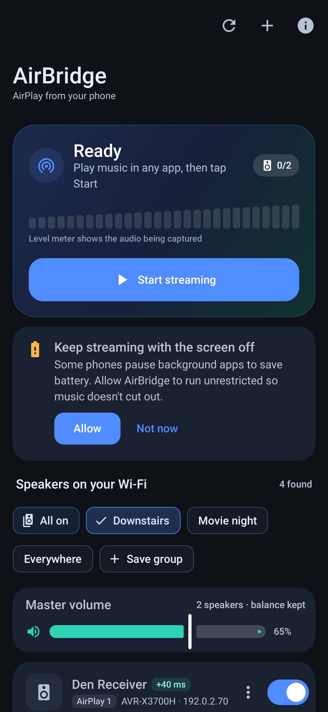
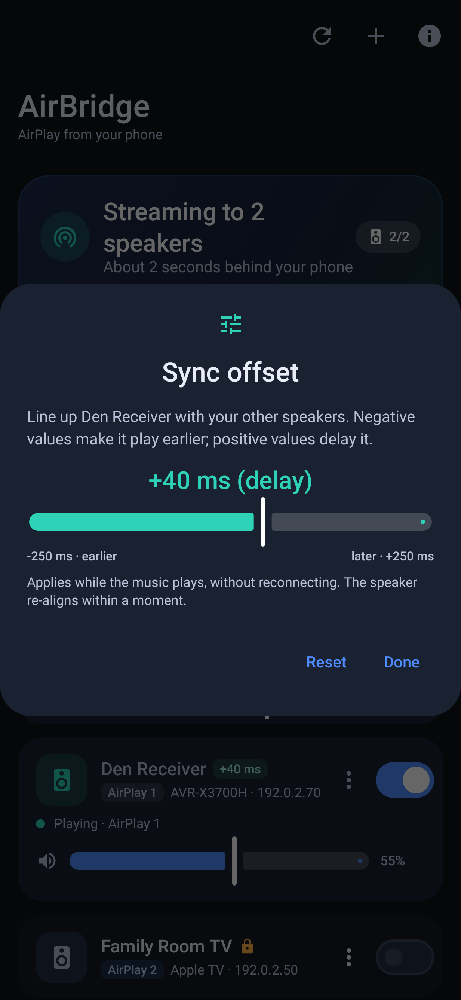
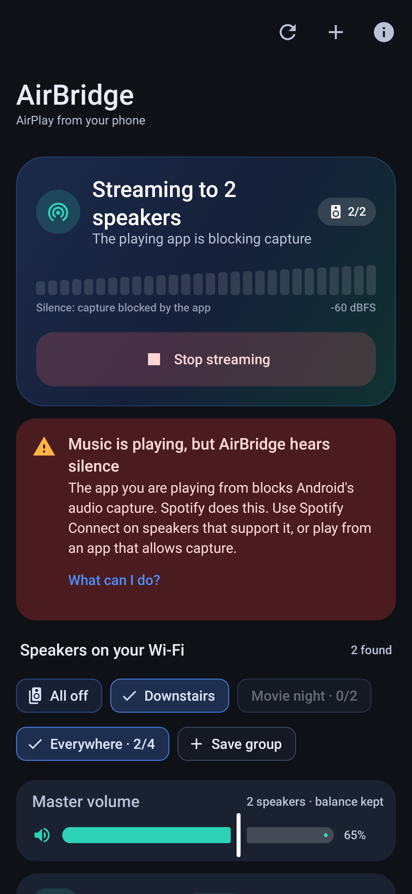

# AirBridge: AirPlay sender for Android

AirBridge is an Android app (Android 10 or newer) that captures the audio other apps are playing on
the phone and streams it over local Wi-Fi to AirPlay 1 and AirPlay 2 speakers: Sonos, HomePod,
Apple TV, Denon/Marantz/Yamaha receivers, WiiM, AirPort Express, Shairport-Sync and others. Several
speakers can play at the same time, each with its own volume and sync offset, under one master
volume, and saved speaker groups switch between sets of speakers with one tap.

This `airbridge-android/` folder is a standalone project. It is not part of Edge Sentinel, shares no
code with it and has its own Gradle build. It is licensed under the MIT License; see
[LICENSE](LICENSE) in this folder.

> **Spotify does not work with AirBridge.** Android lets an app capture other apps' audio only
> through the `AudioPlaybackCapture` API, and every app can refuse to be captured. Spotify refuses,
> so Android gives every capture app, AirBridge included, digital silence while Spotify plays. No
> app can get around this on an unrooted phone. AirBridge detects it: if Android reports that music
> is playing but the captured audio has been all zeros for more than 3 seconds, the app shows a red
> banner that explains the cause. For Spotify, use Spotify Connect, which is built into Sonos,
> Denon/Marantz (HEOS), Yamaha (MusicCast), WiiM and many other speakers. AirBridge works with apps
> that allow capture, such as most local music players, many podcast apps and many web browsers.
> Details: [docs/PLAN.md, section 1](docs/PLAN.md#1-the-most-important-limitation-spotify).

## Status

- Version: debug build `v0.2.0-debug` (the app reports version name 0.2.0, version code 2). It
  installs over the earlier `v0.1.0-debug` as an update: same package name, same signing key.
- Tested: 115 automated unit and loopback integration tests pass on the JVM. The loopback tests run
  complete AirPlay 1 and AirPlay 2 sessions over real network sockets against mock receivers,
  including the v0.2.0 master volume, sync offset, groups and All on / All off with live mock
  speakers. Android lint reports no issues. See [docs/BUILD-TEST-REPORT.md](docs/BUILD-TEST-REPORT.md).
- Not tested yet: a real phone and real speakers. No phone, emulator or speaker was available for
  the build, so acceptance by each speaker model (especially AirPlay 2 with NTP timing) and how
  smoothly each model follows a sync-offset change still have to be checked on real hardware.

## Features

- **AirPlay 1 (RAOP):** ALAC or PCM audio, RSA/AES encryption where the receiver needs it, and
  password (digest) authentication.
- **AirPlay 2:** HomeKit (HAP) pairing: transient pairing with PIN `3939`, the 4-digit code shown on
  an Apple TV, or a speaker password. Encrypted RTSP control channel, ChaCha20-Poly1305 encrypted
  audio packets, NTP timing.
- **Several speakers at once:** every speaker gets its own connection and thread, so a slow speaker
  cannot hold up the others. All speakers share one clock. Each speaker has its own volume slider.
- **Master volume (new in v0.2.0):** one slider moves every speaker that is on and keeps their
  balance; dragging down and back up returns each speaker to where it was.
- **Per-speaker sync offset (new in v0.2.0):** each speaker's menu has a Sync offset dialog,
  -250 ms (earlier) to +250 ms (later) in 5 ms steps, with a Reset button. A small badge such as
  "+40 ms" marks speakers with an offset. The change applies while the music plays, without
  reconnecting.
- **Saved groups and All on / All off (new in v0.2.0):** save the speakers that are on as a named
  group, tap a group to play exactly its speakers (members that are offline are skipped), and
  long-press a group to rename or delete it. One tap turns every speaker on or off, also while
  streaming.
- **Discovery:** mDNS/DNS-SD (`_raop._tcp` and `_airplay._tcp`) through Android's NsdManager plus a
  built-in mDNS browser, and manual entry by IP address and port.
- **Automatic protocol choice:** AirPlay 2 where the speaker supports it, otherwise AirPlay 1.
  If AirPlay 2 fails for a reason other than authentication and the speaker also offers AirPlay 1,
  AirBridge switches to AirPlay 1 automatically. Each speaker's menu can force either protocol.
- **Runs in the background:** a foreground service with a notification and a Stop button keeps
  streaming while the screen is off. Some Android versions end audio capture when the phone locks;
  AirBridge then stops and says so.
- **Local only:** the app sends network traffic only for discovery and to the speakers you choose.
  It has no accounts, analytics, ads or crash reporting.

Speakers play about 2 seconds behind the phone (the AirPlay network buffer); a sync offset moves one
speaker between 1.75 and 2.25 seconds. That suits music, but not lip-sync with video.

## Screenshots

The screenshots are rendered on the JVM with Robolectric from the app's real Compose UI, using
sample speaker names and addresses from the 192.0.2.0/24 documentation range. They are not photos
of a phone.

| Ready | Streaming a saved group | Every speaker on |
|---|---|---|
|  |  |  |

| Sync offset | Capture blocked (Spotify) |
|---|---|
|  |  |

App icons: [launcher icon](screenshots/00-launcher-icon.png),
[status-bar icon](screenshots/00-status-icon.png).

## Install the prebuilt APK

The standalone AirBridge repository is
[github.com/edge-sentinel-crypto/airbridge-android](https://github.com/edge-sentinel-crypto/airbridge-android).
The prebuilt debug APK is attached to its GitHub release
[v0.2.0-debug](https://github.com/edge-sentinel-crypto/airbridge-android/releases/tag/v0.2.0-debug)
as `AirBridge-debug.apk` (29,284,516 bytes). Direct download:
<https://github.com/edge-sentinel-crypto/airbridge-android/releases/download/v0.2.0-debug/AirBridge-debug.apk>

SHA-256 of `AirBridge-debug.apk`:

```
d4f047de85ba79afa138434ab0897aa55f9828c3cf446b09ea9cceb76c3ee0e2
```

Check the file before you install it: `sha256sum AirBridge-debug.apk` on Linux,
`shasum -a 256 AirBridge-debug.apk` on macOS, or `Get-FileHash .\AirBridge-debug.apk -Algorithm SHA256`
in Windows PowerShell. The APK is signed with a debug key, not a Play Store key, so Android and
Google Play Protect warn about an unknown app; that warning is expected. If v0.1.0-debug is
installed, installing this file updates it in place and keeps the saved speakers and pairings.

Step-by-step install guide (copying the file to the phone or using ADB, permissions, Spotify and
troubleshooting): [docs/INSTALL.md](docs/INSTALL.md).

## Build from source

Requirements: JDK 17 and the Android SDK with `platforms;android-35` and `build-tools;35.0.0`.
Set `ANDROID_HOME` to the SDK folder, or create `local.properties` in this folder with
`sdk.dir=<path to the SDK>` (Git ignores that file). The Gradle wrapper downloads Gradle 8.11.1 and
checks it against the SHA-256 pinned in `gradle/wrapper/gradle-wrapper.properties`.

Run every Gradle command from inside this `airbridge-android/` folder:

```bash
git clone --depth 1 https://github.com/edge-sentinel-crypto/edge-sentinel.git
cd edge-sentinel/airbridge-android
./gradlew testDebugUnitTest            # 115 unit and loopback tests
./gradlew assembleDebug lintDebug      # APK: app/build/outputs/apk/debug/app-debug.apk
```

On Windows, use `gradlew.bat` instead of `./gradlew`, or build in WSL on the Linux file system.
A rebuilt APK is signed with your own debug key, so its SHA-256 differs from the released file.
Toolchain setup without sudo, the optional UI screenshot test and APK checks are in
[docs/INSTALL.md, section 7](docs/INSTALL.md#7-building-the-apk-from-source).

## Documentation

- [docs/PLAN.md](docs/PLAN.md): architecture, audio capture, discovery, the AirPlay 1 and
  AirPlay 2 protocol engines, multi-speaker timing, master volume, sync offset and groups,
  limitations and the on-device test plan.
- [docs/INSTALL.md](docs/INSTALL.md): installing the APK on a phone, first run, everyday use,
  troubleshooting and building from source.
- [docs/BUILD-TEST-REPORT.md](docs/BUILD-TEST-REPORT.md): toolchain, test results, APK inspection
  and what still needs real hardware.

## Project layout

```
airbridge-android/
├── app/                  Android app module (Kotlin, Jetpack Compose, Material 3)
│   └── src/
│       ├── main/         app code: audio capture, discovery, AirPlay 1/2 engines, multi-room, UI
│       └── test/         unit and loopback integration tests, mock receivers
├── docs/                 PLAN.md, INSTALL.md, BUILD-TEST-REPORT.md
├── screenshots/          rendered UI screenshots and app icons
├── gradle/               version catalog and Gradle wrapper
├── build.gradle.kts, settings.gradle.kts, gradle.properties, gradlew, gradlew.bat
├── LICENSE               MIT License
└── README.md
```

## License

AirBridge is licensed under the MIT License, copyright 2026 AirBridge Contributors; see
[LICENSE](LICENSE). The proprietary Edge Sentinel license in the root of this repository covers
Edge Sentinel; it does not apply to this folder. The Gradle wrapper files (`gradlew`, `gradlew.bat`
and `gradle/wrapper/gradle-wrapper.jar`) come from Gradle and are licensed under the Apache License
2.0, as stated in the headers of `gradlew` and `gradlew.bat`. Libraries such as AndroidX, Jetpack
Compose and BouncyCastle are downloaded by Gradle at build time and keep their own licenses.

AirPlay, HomePod and Apple TV are trademarks of Apple Inc. Spotify and Spotify Connect are
trademarks of Spotify AB. Sonos is a trademark of Sonos, Inc. AirBridge is an independent project
and is not affiliated with or endorsed by Apple, Spotify or Sonos.
